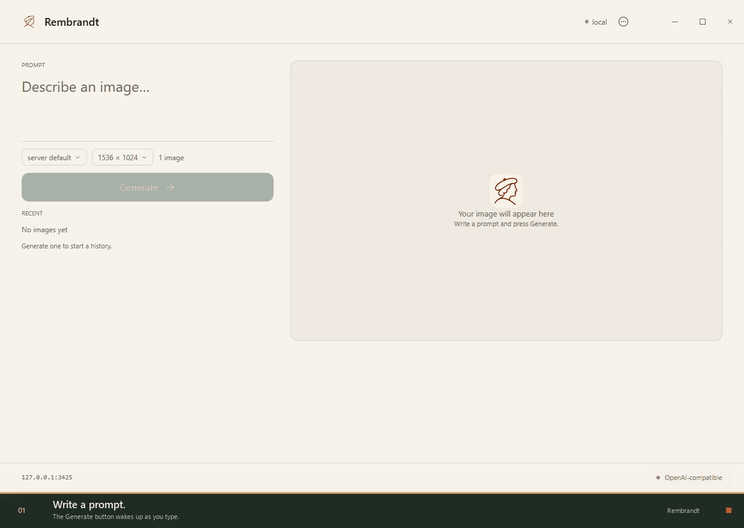
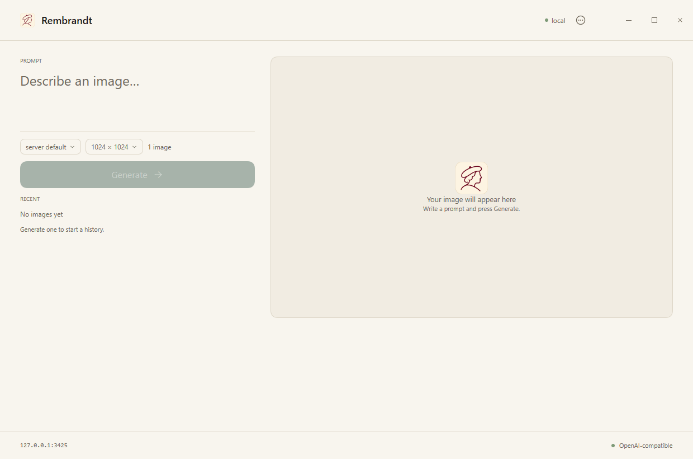
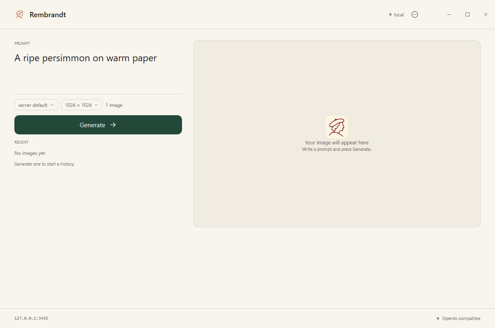
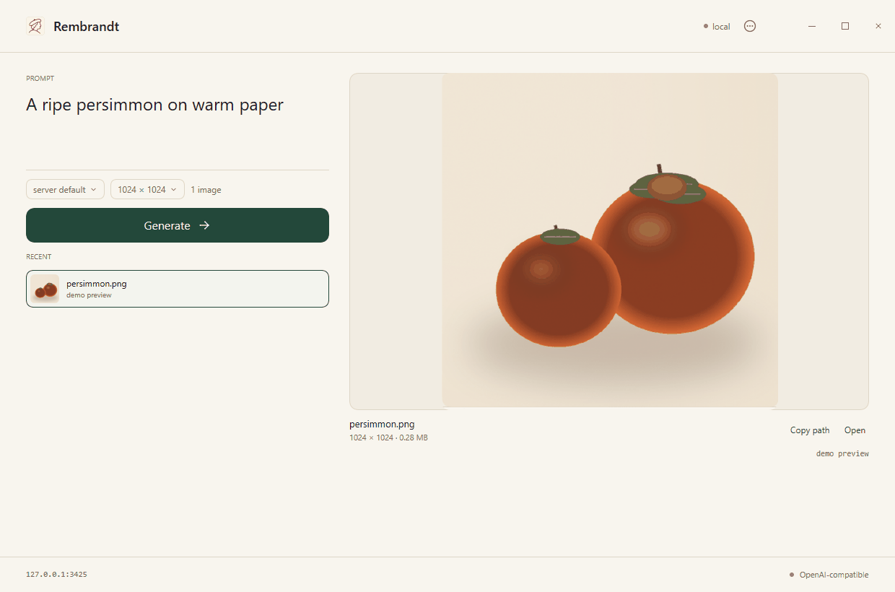
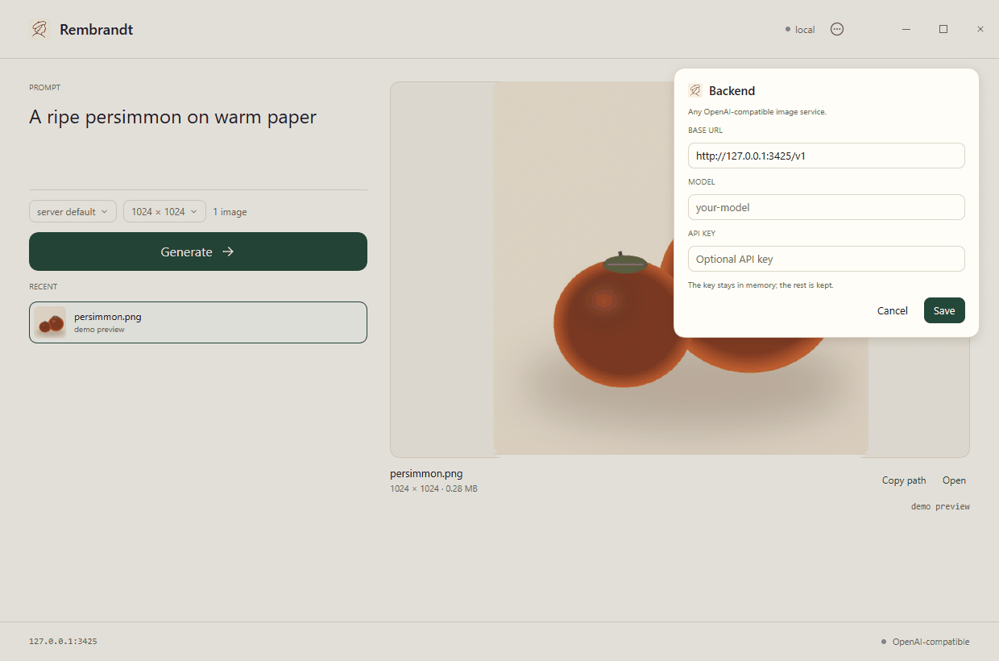

# Rembrandt

Rembrandt turns a text prompt into an image in a small native Windows app.
It sends the prompt to an OpenAI-compatible image service (the **backend**),
then shows the result beside the composer. There is no browser or Electron
layer, and no account of its own.

[**Download Rembrandt for Windows**](https://github.com/lsj5031/rembrandt/releases/latest/download/rembrandt-windows-x86_64.exe)

The download is a single `.exe`. It is not signed, so Windows may show a
SmartScreen warning. Choose **More info → Run anyway** only if you downloaded
it from this repository.

## Quick start

1. **Start your image service.** Rembrandt is the interface; the backend is
   the service that actually creates the image. The default address is
   `http://127.0.0.1:3425/v1`. If your service runs elsewhere, change it in
   **Backend** after launching.
2. **Run `rembrandt-windows-x86_64.exe`.**
3. **Type a prompt** in the left column, for example:
   *A ripe persimmon on warm paper.*
4. **Choose a size**, or leave the default landscape size.
5. **Press Generate.** The image appears on the right and is saved to your
   `Documents\Rembrandt` folder.

You can open Rembrandt without a backend to look around. Generate will fail
until a service is configured.

## Make an image

1. Type what you want in the large prompt field. Generate becomes available
   as soon as the field contains text.
2. Press the size chip to cycle through:
   - landscape — `1536 × 1024`
   - square — `1024 × 1024`
   - portrait — `1024 × 1536`
3. Press **Generate**. Rembrandt sends one request at a time and waits up to
   four minutes for the backend to answer.
4. The result appears on the right. It is added to **Recent** for this
   session.

Each generated image is saved as:

```text
Documents\Rembrandt\rembrandt-<timestamp>.png
```

The PNG stays on disk after Rembrandt closes. The Recent list and the current
preview are per session, so they start empty the next time you launch the app.

## Work with a result

Below the preview you can:

- **Copy path** — copy the full PNG path to the clipboard.
- **Open** — open the PNG in your default image viewer.
- Click a **Recent** row to show that image in the preview again.

The preview also shows the image dimensions, file size, generation time, and
token count.

## Change the backend

Open **Backend** using either:

- the model chip in the left column, or
- the `...` button in the header.

Then edit:

- **Base URL** — the address of your OpenAI-compatible image service.
- **Model** — optional; leave it blank to use the service's default model.
- **API key** — the token your service expects, if any.

Press **Save** to apply the settings. Press **Cancel**, click outside the
panel, or press Escape to dismiss it.

The base URL, model, and size are remembered for next time. The API key is
kept in memory only; it is never written to disk and must be entered again
after restarting the app.

## Connect a backend

Your backend must:

- accept `POST <base URL>/images/generations`;
- return an OpenAI-compatible response containing a PNG in
  `data[0].b64_json`.

The defaults are:

| Setting | Default |
| --- | --- |
| Base URL | `http://127.0.0.1:3425/v1` |
| Model | server default |
| Size | `1536x1024` |

You can set the connection before launching with environment variables.
In PowerShell:

```powershell
$env:REMBRANDT_BASE_URL = "https://images.example.com/v1"
$env:REMBRANDT_API_KEY = "your-token"
$env:REMBRANDT_MODEL = "your-model"
.\rembrandt-windows-x86_64.exe
```

In bash:

```sh
export REMBRANDT_BASE_URL="https://images.example.com/v1"
export REMBRANDT_API_KEY="your-token"
export REMBRANDT_MODEL="your-model"
./rembrandt-windows-x86_64.exe
```

| Variable | Purpose |
| --- | --- |
| `REMBRANDT_BASE_URL` | Service address; a bare host is normalized to include `/v1`. |
| `REMBRANDT_API_KEY` | Bearer token sent to the service. |
| `REMBRANDT_MODEL` | Model name; leave empty for the server default. |
| `REMBRANDT_SIZE` | `1536x1024`, `1024x1024`, or `1024x1536`. |

## Screenshots and walkthrough

A nine-second walkthrough of the actual interface:

[](docs/media/rembrandt-walkthrough.mp4)

[Watch the walkthrough (MP4)](docs/media/rembrandt-walkthrough.mp4)

| Empty | Prompt ready |
| :---: | :---: |
|  |  |
| **Result** | **Backend** |
|  |  |

The result view is seeded with a demo image for the screenshots.

## Troubleshooting

### Generate says “That didn't work”

The app reached the request stage, but the backend did not return an image.
Check, in order:

1. The backend is running.
2. The base URL points to the right host and ends with the expected `/v1`.
3. The API key is valid and has access to the model.
4. The model name exists on the server.
5. The log file for the full error (path below).

### Generate looks disabled

Type a prompt first. The button becomes available when the prompt is not empty.

### The API key disappears after restart

That is intentional. The key is never saved. Enter it in **Backend** again, or
provide `REMBRANDT_API_KEY` before launching.

### I cannot find my image

Generated files are in `Documents\Rembrandt`. The Recent list is only for the
current session; the PNG files remain on disk.

### Windows blocked the executable

The release build is unsigned. Use **More info → Run anyway** if you downloaded
the file from this repository. If you are unsure where it came from, delete it.

### Zig cannot find nanoui

This only affects building from source. The build expects `nanoui` in a sibling
folder. See [Build from source](#build-from-source).

## Settings, logs, and privacy

Rembrandt stores non-secret settings here:

```text
%APPDATA%\Rembrandt\settings.json
```

It writes a synchronous log here:

```text
%LOCALAPPDATA%\Rembrandt\rembrandt.log
```

The previous run is kept as `rembrandt.log.1`. The log records startup,
connection metadata, generated file paths, and errors. The API key and prompt
text are never logged.

Set `REMBRANDT_LOG=off` to disable logging, or `REMBRANDT_LOG=path` to put the
log somewhere else.

## Build from source

You only need this section if you are developing Rembrandt or do not want to
use the release executable.

Requirements:

- Windows 10 or 11
- Zig `0.17.0`
- A sibling checkout of [nanoui](https://github.com/justrach/nanoui)

```text
parent/
├─ nanoui/
└─ rembrandt/
```

Clone the projects:

```sh
git clone https://github.com/lsj5031/rembrandt
cd rembrandt
git clone https://github.com/justrach/nanoui ../nanoui
```

Build and open the app:

```sh
zig build run -Doptimize=ReleaseFast
```

The build creates `zig-out\bin\rembrandt.exe`.

For development, `zig build` without the flag creates a Debug build. If
`nui` is on your `PATH`, `nui run` also works.

## Development

Run the offscreen tests (no window, no network):

```sh
zig build test -Doptimize=ReleaseFast
```

With `nui` available, render the interface to a PNG without opening a window:

```sh
nui snapshot --out shot.png
```

For a repeatable result state, preload an image:

```powershell
$env:REMBRANDT_DEMO_IMAGE = "C:\path\to\picture.png"
nui snapshot --out shot.png
```

`REMBRANDT_PROMPT` pre-fills the composer for snapshots.

### Layout

```text
build.zig            build, run, test, and icon resource steps
assets/rembrandt.svg icon source
assets/rembrandt.ico embedded Windows icon
assets/rembrandt.rc  Windows resource file
src/main.zig         app setup, window, and custom Windows frame
src/app.zig          state and the whole view
src/controls.zig     shared buttons, chips, and press feedback
src/win_frame.zig    Windows caption removal, drag regions, window icon
src/backend.zig      endpoint config, request/response, PNG helpers
src/settings_store.zig persisted base URL/model/size (never the key)
src/log.zig          synchronous run log
src/theme.zig        paper/pine palette
src/mark.svg         header and empty-state mark
src/tests.zig        offscreen view tests
docs/media/          README screenshots, GIF preview, and walkthrough video
```

`AGENTS.md` contains the repository's rules for automated coding agents.

## License

Rembrandt is available under the [MIT License](LICENSE). The bundled
[nanoui](https://github.com/justrach/nanoui) UI framework is also MIT-licensed;
see [THIRD_PARTY_NOTICES.md](THIRD_PARTY_NOTICES.md).
